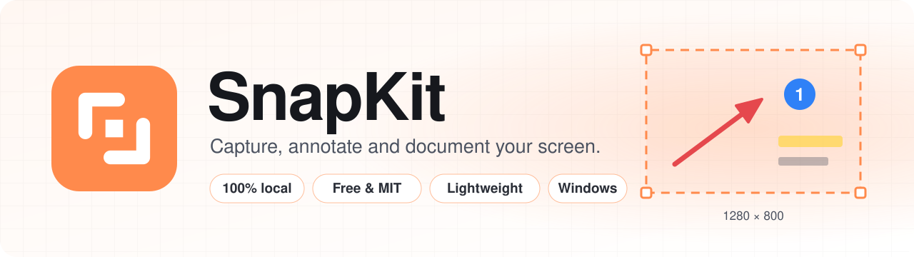
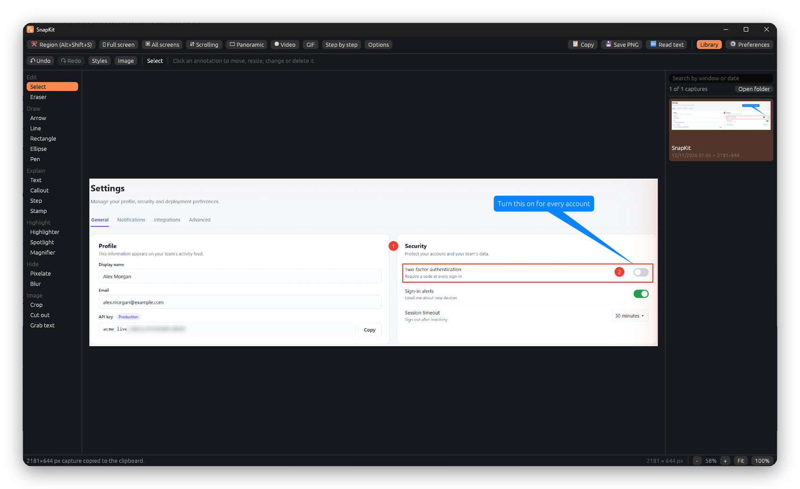
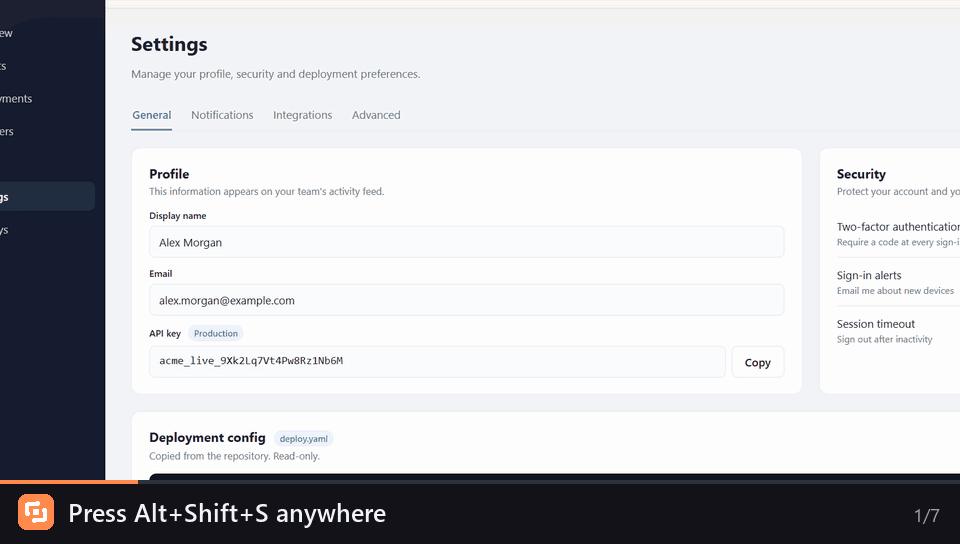
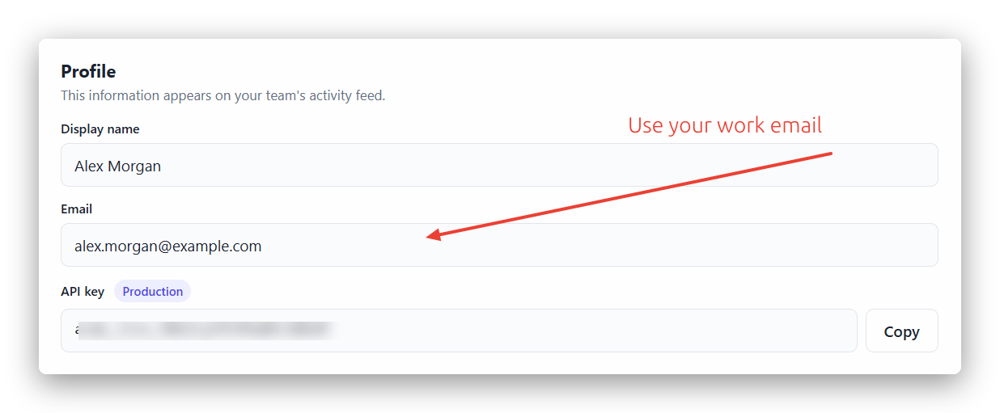

<p align="center">
  <picture>
    <source media="(prefers-color-scheme: dark)" srcset="assets/banner-dark.svg">
    <source media="(prefers-color-scheme: light)" srcset="assets/banner-light.svg">
    
  </picture>
</p>

<p align="center">
  <b>The screen capture tool for people who write documentation.</b><br>
  Powerful, free and lightweight. Runs 100% on your computer: no account, no cloud, no telemetry.
</p>

<p align="center">
  <a href="https://github.com/MichelGSS/snapkit/releases/latest"></a>
  <a href="https://github.com/MichelGSS/snapkit/releases"></a>
  <a href="https://github.com/MichelGSS/snapkit/actions/workflows/ci.yml"></a>
  <a href="LICENSE"></a>
  
  
</p>

<p align="center">
  <a href="https://github.com/MichelGSS/snapkit/releases/latest"><b>⬇️ Download</b></a>
  &nbsp;·&nbsp;
  <a href="docs/README.md"><b>📖 User guide</b></a>
  &nbsp;·&nbsp;
  <a href="#-features"><b>✨ Features</b></a>
  &nbsp;·&nbsp;
  <a href="#-faq"><b>❓ FAQ</b></a>
  &nbsp;·&nbsp;
  <a href="https://github.com/MichelGSS/snapkit/issues/new/choose"><b>🐞 Report a problem</b></a>
</p>

<br>

<p align="center">
  
</p>

---

## 🧭 Why SnapKit

<table>
  <tr>
    <td width="50%" valign="top">
      <h3>🔒 100% local</h3>
      Capture, annotation, text recognition and video encoding all run on your machine. SnapKit never opens a network connection, so it's safe for internal tools, customer data and air-gapped networks.
    </td>
    <td width="50%" valign="top">
      <h3>💸 Free, for real</h3>
      MIT licensed and open source. No sign-up, no subscription, no "Pro" tier, no watermark, no ads. Use it at home and at work.
    </td>
  </tr>
  <tr>
    <td width="50%" valign="top">
      <h3>🪶 Lightweight</h3>
      One native app written in Rust. A 66 MB installer, about 100 MB of memory while idle, no background services and no updater running behind your back.
    </td>
    <td width="50%" valign="top">
      <h3>📝 Made for documentation</h3>
      Quick annotation, numbered steps, step-by-step guides, scrolling capture, OCR that keeps code indentation and GIFs for pull requests. The things you do every day, one shortcut away.
    </td>
  </tr>
</table>

## ⚡ See it in action

Press **Alt+Shift+S**, drag over what you need, annotate it right where it is, and press **Enter**. The editor never opens: the image is already on your clipboard.

<p align="center">
  
</p>

<details>
<summary><b>And this is what lands on your clipboard</b></summary>
<br>
<p align="center">
  
</p>
</details>

## ✨ Features

<table>
  <tr>
    <th width="33%">📸 Capture</th>
    <th width="33%">🖍️ Annotate</th>
    <th width="33%">📤 Text, video and library</th>
  </tr>
  <tr>
    <td valign="top">

- **Region, window, full screen** and **all screens**
- **Live overlay**: nothing freezes, windows are detected, and a magnifier helps you hit the pixel
- **Scrolling capture**: vertical, horizontal or both, with fixed headers detected
- **Panoramic capture**: scroll by hand in any direction
- **Step by step**: every click becomes a numbered, captioned shot of one guide
- **Delay** of 3, 5 or 10 s for menus and tooltips

</td>
    <td valign="top">

- **Quick annotation** right on the screen
- **19 tools**: arrows, shapes, pen, text, callouts, numbered steps, 16 stamps, highlighter, spotlight, magnifier, pixelate, blur, eraser, crop, cut out
- **Everything stays editable**: move, resize, recolor or retype any annotation later
- **Styles** to reuse your favorite settings in one click
- Rotate, flip, resize, border and **drop shadow**

</td>
    <td valign="top">

- **OCR** with Tesseract (English and Portuguese) that keeps indentation and blank lines
- A **neural engine** for handwriting
- **Screen recording** to MP4 with system sound and microphone, pause and resume
- **Trim** and convert to **GIF** in one window
- **Library** of every capture, with thumbnails and search
- English and Portuguese, **9 themes**, tray icon

</td>
  </tr>
</table>

## 👥 Who it's for

| If you're a… | SnapKit helps you… |
|---|---|
| **Technical writer** | Build step-by-step guides, number UI elements and keep every screenshot consistent with saved styles. |
| **Support agent** | Answer tickets with an annotated screenshot in seconds, and blur customer data before you send it. |
| **QA engineer** | Report bugs with a clear capture, a scrolling capture of the whole page or a short recording with sound. |
| **Developer** | Drop GIFs into pull requests and copy code, logs or YAML out of a screenshot with its indentation intact. |
| **Trainer** | Turn a task into a numbered guide while you do it, then polish the captions in the editor. |

## 🔐 What you won't find in SnapKit

| | |
|---|---|
| ❌ Accounts or sign-in | ❌ Cloud uploads or share links |
| ❌ Telemetry, analytics or tracking | ❌ Subscriptions, trials or paid tiers |
| ❌ Watermarks or ads | ❌ Background services or auto-updaters |

Your captures are plain PNG files in your **Pictures** folder and your recordings are MP4 files in **Videos**. Read more in [Why SnapKit is 100% local](docs/explanation/local-first.md).

## 🚀 Get started

1. **Download** `SnapKit-<version>-setup.exe` from the [latest release](https://github.com/MichelGSS/snapkit/releases/latest).
2. **Install** it. It installs for your user only and doesn't ask for administrator rights.
3. **Press Alt+Shift+S** and drag over anything on your screen.

Prefer a portable app? Download `SnapKit-<version>-windows-x64.zip`, extract it and run `snapkit.exe`.

> [!NOTE]
> The installer isn't code-signed yet, so Windows SmartScreen may show **Windows protected your PC**. Select **More info** > **Run anyway**, check the SHA-256 checksums on the release page, or [build SnapKit from source](docs/how-to/build-from-source.md).

**Requirements:** Windows 10 version 2004 or later, or Windows 11, 64-bit. See [System requirements and limits](docs/reference/requirements-and-limits.md).

### Shortcuts to remember

| Shortcut | What it does |
|---|---|
| <kbd>Alt</kbd>+<kbd>Shift</kbd>+<kbd>S</kbd> | Start a region capture from any app |
| <kbd>Enter</kbd> | Copy the annotated capture and close |
| <kbd>Ctrl</kbd>+<kbd>S</kbd> | Save the capture to a file |
| <kbd>Ctrl</kbd>+<kbd>E</kbd> | Continue in the full editor |
| <kbd>Ctrl</kbd>+<kbd>Z</kbd> / <kbd>Ctrl</kbd>+<kbd>Y</kbd> | Undo / redo |
| <kbd>Esc</kbd> | Cancel |

All shortcuts are in the [keyboard shortcuts reference](docs/reference/keyboard-shortcuts.md).

## 📖 Documentation

The [user guide](docs/README.md) covers everything SnapKit does. It's organized with the [Diátaxis](https://diataxis.fr) framework and written following the Microsoft Writing Style Guide.

| | Section | Start with |
|---|---|---|
| 🎓 | **Tutorials**: learn by doing | [Take, annotate and share your first screenshot](docs/tutorials/first-screenshot.md) |
| 🛠️ | **How-to guides**: get a task done | [Capture a long page with scrolling capture](docs/how-to/capture-scrolling.md) |
| 📚 | **Reference**: look up a detail | [Editor tools and options](docs/reference/editor-tools.md) |
| 💡 | **Explanation**: understand how it works | [How text recognition works](docs/explanation/text-recognition.md) |

## ❓ FAQ

<details>
<summary><b>Is SnapKit really free?</b></summary>
<br>
Yes. SnapKit is released under the MIT License. There's no paid version, no trial and no feature held back. You can use it at work, share it with your team and modify it.
</details>

<details>
<summary><b>Does SnapKit send anything over the internet?</b></summary>
<br>
No. SnapKit has no network code at all: no telemetry, no update checks and no cloud features. Text recognition and video encoding run locally with bundled engines.
</details>

<details>
<summary><b>Where are my screenshots saved?</b></summary>
<br>
Every capture is saved as a PNG in <code>Pictures\SnapKit</code>, and recordings go to <code>Videos\SnapKit</code>. Preferences live in <code>%APPDATA%\SnapKit</code>. See <a href="docs/reference/files-and-folders.md">Files and folders</a>.
</details>

<details>
<summary><b>Can I change an arrow after I've drawn it?</b></summary>
<br>
Yes. Every annotation stays a separate object while the capture is open: select it to move, resize, recolor, retype, duplicate or delete it. See <a href="docs/explanation/annotations.md">How annotations work</a>.
</details>

<details>
<summary><b>Can I use the Print Screen key?</b></summary>
<br>
Yes. In <b>Preferences</b>, set the global shortcut to <b>PrintScreen</b> with no modifiers. See <a href="docs/how-to/customize.md#change-the-capture-shortcut">Change the capture shortcut</a>.
</details>

<details>
<summary><b>Does it work on macOS or Linux?</b></summary>
<br>
Not yet. SnapKit is Windows-first and uses Windows APIs for capture, the tray and the overlay. Contributions toward other platforms are welcome.
</details>

<details>
<summary><b>Which languages does the interface support?</b></summary>
<br>
English and Portuguese. SnapKit follows your Windows language the first time and you can switch it anytime in <b>Preferences</b>.
</details>

## 🧑‍💻 Build from source

```powershell
git clone https://github.com/MichelGSS/snapkit.git
cd snapkit
cargo run
```

You need [Rust](https://rustup.rs) (stable) and the Visual Studio Build Tools with the C++ workload. OCR and video use third-party binaries that the scripts in `scripts\` download. See [Build SnapKit from source](docs/how-to/build-from-source.md).

<details>
<summary><b>Code map</b></summary>
<br>

| Path | Contents |
|---|---|
| `src/main.rs` | Main window, selection overlay, floating panels, preferences |
| `src/capture.rs` | Monitor capture and window list |
| `src/editor.rs`, `src/render.rs` | Annotation editor and image rendering |
| `src/scroll.rs` | Scrolling and panoramic capture: motion detection and stitching |
| `src/steps.rs` | Step-by-step capture |
| `src/ocr.rs`, `src/neural.rs` | Text recognition: Tesseract, neural engine and layout |
| `src/record.rs`, `src/audio.rs` | Video recording (FFmpeg) and audio capture |
| `src/library.rs` | Capture library on disk |
| `src/i18n.rs` | English and Portuguese interface texts |
| `src/win.rs` | Direct Windows API calls |
| `src/tray.rs`, `src/config.rs`, `src/theme.rs`, `src/autostart.rs` | Tray, preferences, themes, start with Windows |

</details>

## 🤝 Contributing

Bug reports, ideas, documentation fixes and pull requests are all welcome.

- Read [CONTRIBUTING.md](CONTRIBUTING.md) to get started.
- See the [roadmap](ROADMAP.md) for what's planned.
- Report security problems privately, as described in [SECURITY.md](SECURITY.md).

If SnapKit saves you time, a ⭐ on GitHub helps other people find it.

## 🙏 Built with

SnapKit stands on the shoulders of great open-source projects: [egui](https://github.com/emilk/egui), [Tesseract](https://github.com/tesseract-ocr/tesseract), [PaddleOCR](https://github.com/PaddlePaddle/PaddleOCR) models on [ONNX Runtime](https://github.com/microsoft/onnxruntime), [FFmpeg](https://ffmpeg.org), [tiny-skia](https://github.com/RazrFalcon/tiny-skia) and [xcap](https://github.com/nashaofu/xcap). The full list is in [THIRD-PARTY-NOTICES.md](THIRD-PARTY-NOTICES.md).

## 📄 License

SnapKit is released under the [MIT License](LICENSE). The installer and the zip also include third-party programs under their own open-source licenses, listed in [THIRD-PARTY-NOTICES.md](THIRD-PARTY-NOTICES.md).

<br>

<p align="center">
  <br>
  <sub>Made with Rust for people who explain things with screenshots.</sub>
</p>
